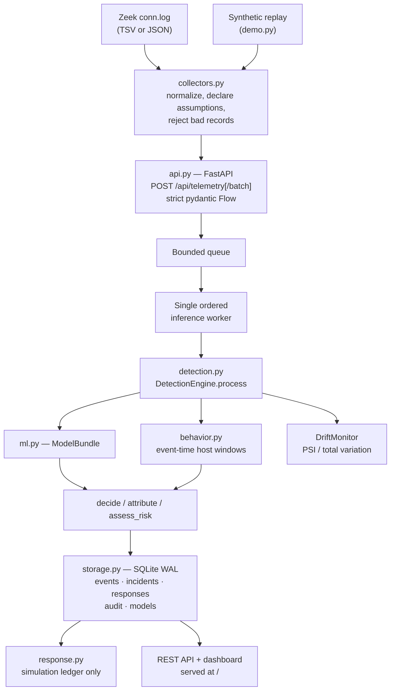
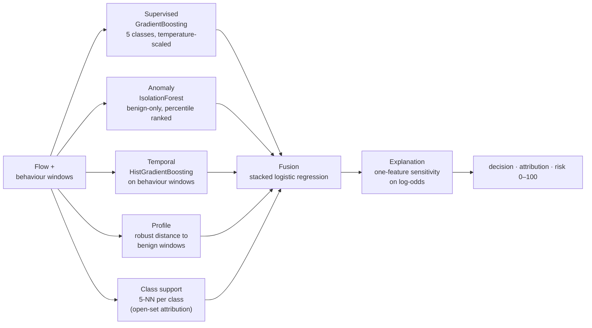

# AegisWeave — Technical Design Document

Evidence-aware machine-learning network intrusion detection, built for environments
that have network telemetry but no security analyst.

This document describes the design as implemented. Measured results live in the
[README](../README.md#measured-results); API details live in [API.md](API.md).

---

## 1. Scope and design constraints

Three constraints shaped every component:

1. **No packet capture, no probing.** AegisWeave consumes flow telemetry that the
   network already produces (Zeek `conn.log`). It never opens a capture socket, never
   sends a probe, and never reads payload. This keeps it deployable on networks holding
   student or patient records without becoming a privacy liability itself.
2. **Evidence over verdicts.** Every decision carries the evidence that produced it —
   which layer fired, which feature moved the score, how far the flow sits from known
   behaviour. A verdict a non-specialist cannot interrogate is not useful to them.
3. **Response is simulated, never live.** The response engine records what it *would*
   have done to an audit ledger. No live blocking adapter exists. An autonomous system
   that can cut network access in a clinic is a bigger risk than the intrusion.

Labels and asset criticality are never accepted as telemetry inputs — they would leak
ground truth into inference.

---

## 2. System architecture

---

## 3. Data model

Telemetry is validated by a strict `Flow` model (`schema.py`) that forbids unknown
fields and rejects anything unmeasured rather than guessing it.

| Field | Type | Notes |
|---|---|---|
| `event_id` | str | Stable ID; defaults to a UUID4 |
| `timestamp` | datetime | Must carry a timezone; normalized to UTC |
| `source`, `destination` | str | Canonical IP addresses; scoped addresses rejected |
| `source_port`, `destination_port` | int | 0–65535 |
| `protocol` | enum | TCP / UDP / ICMP / OTHER |
| `duration` | float | Seconds, ≤ 7 days |
| `packets`, `bytes` | int | Forward direction |
| `reverse_packets`, `reverse_bytes` | int | Responder direction |
| `failed` | bool | Connection failed |
| `syn_ratio` | float | 0–1 |
| `sensor_id` | str | Which sensor reported the flow |
| `missing_features` | list | Auto-declared for any optional counter not supplied |
| `measurement_assumptions` | list | Set by the collector when a value was derived, not measured |

A flow must have at least one measured packet in some direction. The last two fields
are the backbone of the evidence model: a consumer can always tell a measurement from
an assumption.

---

## 4. Detection pipeline

`DetectionEngine.process` fuses five independent layers. No single layer can convict a
flow on its own.

**Why this shape.** A supervised model alone cannot see an attack class it was never
trained on — the reason signature tools fail on new attacks. The benign-only
IsolationForest and the profile-distance layer need no attack examples at all, so a
novel attack still registers as *far from normal* even when the classifier is
confident and wrong. Class support is a distance, not a probability: it is necessary
but not sufficient for attribution, which is why an open-set result can come back
explicitly `unattributed`.

### Behaviour windows

`behavior.py` maintains event-time windows per host at 5 / 30 / 60 / 300 seconds.
Zeek emits a connection when it *ends*, so flows arrive out of order; records up to
300 s late are re-sequenced into their correct window. The behaviour engine never
learns from live data — it only measures against the fitted reference.

### Decisions

`decide()` returns one of: `normal`, `suspicious`, `anomalous`, `malicious`, `unknown`.
`unknown` is a first-class outcome, not a failure. `assess_risk()` scores 0–100, capped
by the decision, with trusted-asset importance read from local config rather than
telemetry.

### Drift

`DriftMonitor` compares live windows to the training distribution using PSI and total
variation. It raises a review signal only — **it never triggers retraining**, so live
traffic can never silently reshape the model.

---

## 5. Storage, response, and access

- **Storage** (`storage.py`): SQLite in WAL mode — events, incidents (correlated by
  source + sensor + time), responses, audit trail, model registry.
- **Response** (`response.py`): a policy pipeline — allowlist → risk and confidence
  gates → approval → TTL expiry → rollback → kill switch — writing to a simulation
  ledger. `simulation` is typed `Literal[True]`; it cannot be configured off.
- **Auth** (`auth.py`): admin / analyst / viewer role tokens from environment
  variables, or a loopback-only session for demos. Tokens are never passed on the
  command line.
- **Dashboard** (`frontend/`): a dependency-free HTML, CSS and JavaScript page served
  at `/`. No build step and no framework runtime — it has to stay serviceable on
  hardware and by people without a front-end toolchain.

---

## 6. Technology stack

| Layer | Choice |
|---|---|
| Language | Python 3.12+ |
| API | FastAPI, Uvicorn, Pydantic (strict models) |
| ML | scikit-learn (GradientBoosting, HistGradientBoosting, IsolationForest) |
| Numerics | NumPy, pandas, SciPy, joblib |
| Storage | SQLite (WAL) |
| Dashboard | Static HTML / CSS / JavaScript |
| Packaging | setuptools, Docker, Compose |
| Tests | pytest |

Model choices are deliberate: gradient-boosted trees on ~10 numeric flow counters fit
in tens of megabytes and score a flow in milliseconds on a low-power box. A deep model
would cost more hardware than the institutions this targets can buy, and would be
harder to explain to the people who have to act on its alerts.

---

## 7. Evaluation

Benchmarked offline against public datasets through strict adapters (`datasets.py`)
that map each corpus onto one shared reduced numeric schema, with no fabricated
addresses, time order, failures, SYN ratios, or temporal context:

- **UNSW-NB15** — real lab traffic, reduced to 10 generic counters
- **CICIDS2017** — offline counter baseline
- **IoT-23** — real traffic, context-corrected evaluation
- **Synthetic episodes** — seeded, independent host episodes

`check_split_isolation` enforces that no host or episode appears in more than one
split, so reported scores are not leakage. Current figures are in the README.

---

## 8. Known limitations

- Reduced to ~10 generic flow counters, so attacks distinguished only by payload or
  by protocol-specific fields are out of reach by construction.
- Response is simulation-only; there is no enforcement path.
- Encrypted traffic is handled because detection never needed payload — but that also
  caps how precisely an attack can be attributed.
- Benchmarks are offline. Live pilot deployment is future work.
